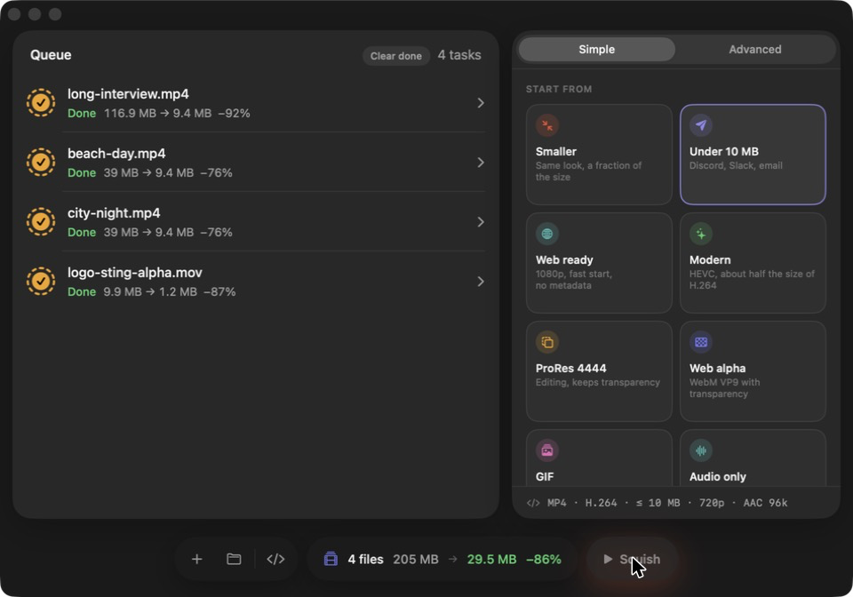

# Squish

A native Mac app for compressing and converting video, built on ffmpeg. Pick a preset and go, or open Advanced mode for nearly every ffmpeg setting worth using. It handles transparent video, HDR from iPhones, and audio-only exports too.



## Download & install

**Requires a Mac with Apple silicon (M1 or later) running macOS 15 or newer.** Everything Squish needs, including ffmpeg, is inside the app.

1. Download **Squish-x.y.z.dmg** from the [latest release](https://github.com/devinscottfountain/squish/releases/latest).
2. Open the DMG and drag **Squish** into **Applications**.
3. Open Squish from Applications. The first time, macOS stops it (see below).

### "Apple could not verify Squish…"

Squish isn't signed with a paid Apple Developer ID, so macOS can't check it automatically and blocks the first launch. You only need to approve it once:

1. Open Squish. When the warning appears, click **Done** (not Move to Trash).
2. Open **System Settings › Privacy & Security** and scroll down to **Security**.
3. Next to "Squish was blocked to protect your Mac", click **Open Anyway**.
4. Click **Open Anyway** again in the dialog that appears, and enter your password or use Touch ID if asked. From now on Squish opens normally.

**Prefer Terminal?** This does the same thing. It removes the "downloaded from the internet" flag so macOS stops asking:

```bash
xattr -dr com.apple.quarantine /Applications/Squish.app
```

**Is this safe?** The warning means Apple hasn't reviewed the app, not that anything is wrong with it. Squish is open source: everything in the app is built from the code in this repository, including the script that builds its bundled ffmpeg (`Tools/build-ffmpeg.sh`). If you'd rather not trust a download, [build it yourself](#build-from-source).

**Updating:** download the new DMG and replace the app in Applications. You'll need to approve it again on first launch.

## What it does

**Simple mode:** one-tap presets: Smaller, Under 10 MB, Web ready, Modern (HEVC), ProRes 4444, Web alpha, GIF, Audio only and Archive. You can also save your own. Below the presets: format, quality *or* a target file size, resolution, and switches for audio, transparency, metadata and HDR. **Fastest** uses the Mac's media engine and **Smallest** uses software encoders.

**Advanced mode:**
- **Format:** MP4, MOV, MKV, WebM, GIF, WebP, APNG, PNG frames, or audio only (M4A/AAC, ALAC, MP3, WAV, FLAC). Video can be H.264, HEVC, AV1, VP9, ProRes or passthrough, with the media engine or software encoders.
- **Video:** quality, bitrate, two-pass, target file size or CBR. Also encoder speed, tune, profile, bit depth, keyframes and B-frames.
- **Frame:** resolution (portrait-aware), frame rate with drop, blend or motion interpolation, plus rotate, flip, crop, deinterlace, denoise, sharpen and color adjustments.
- **Time:** trim, 0.25×–4× speed with pitch-preserving audio, reverse, fades.
- **Audio:** codec, bitrate, sample rate, channels, gain, and loudness normalization.
- **Transparency:** keep alpha (ProRes 4444, VP9, HEVC, GIF/APNG/PNG), flatten onto a color, or key out a green screen.
- **HDR:** tone-map iPhone, HLG, HDR10 and Dolby Vision footage to SDR, or keep it as 10-bit HDR.
- **Metadata and output:** strip or edit metadata, output folder, file naming, and raw extra ffmpeg arguments.

**Also:**
- **Queue:** drag and drop files or folders. Reorder by dragging, pin settings to individual files, and retry or stop single files. The queue is remembered between launches.
- **Before you encode:** a size estimate for each file (from a short sample encode), and a before/after split-screen preview.
- **While it runs:** live progress, speed and time left, a Dock progress bar, and keep-awake so the Mac doesn't sleep mid-batch.
- **Built in:** the exact ffmpeg command for any file, plus Settings (⌘,) and About with full license notices.

## Performance

Squish is Swift and SwiftUI, built for Apple silicon only. These numbers were measured on an M4 Pro with 1080p30 footage:

| Encoder | Speed (× realtime) | Notes |
|---|---|---|
| H.264, media engine (default) | 6.8–7.5× | Size and quality about even with x264 medium on detailed or grainy footage; files can be larger on flat graphics |
| H.264, x264 medium (Smallest) | 2.3–3.1× | |
| HEVC, media engine | 6.6–6.8× | Quality scale calibrated so q≈48 matches x265 medium |
| HEVC, x265 medium | 1.5–1.9× | |
| AV1, SVT preset 8 | 5.5–7.1× | Smallest files on grainy footage |
| ProRes 422 HQ, media engine | 18.7× | About 4× faster than software; used for 422 profiles |
| ProRes 422 HQ, prores_ks | 4.5× | Still used for 4444 and transparency |

What this means for the defaults:
- **Encoder:** Simple mode defaults to Fastest, the media engine. "Under 10 MB" and "Archive" use software, which hits exact sizes and makes the smallest files.
- **Files at once:** one at a time by default. Each encode already uses every core, so running two side by side wasn't faster.
- **Untagged video:** gets BT.709 (HD) or BT.601 (SD) color tags before it reaches the media engine, which otherwise shifted colors.
- **Size limits are a ceiling:** a file that's already under the limit isn't inflated to fill it.

## Build from source

```bash
brew install xcodegen ffmpeg   # ffmpeg is only needed for development builds
xcodegen generate
open Squish.xcodeproj          # ⌘R to run, ⌘U for the tests
```

Development builds use your Homebrew ffmpeg. Squish looks for ffmpeg in this order:
1. A binary you picked in Settings › ffmpeg.
2. The copy bundled in the app (release builds).
3. `/opt/homebrew/bin`, `/usr/local/bin`, `/opt/local/bin`, then `/usr/bin`.

It runs ffmpeg as a separate process, so the App Sandbox is off.

The tests (`SquishTests`, Swift Testing) cover the command builder and also run real encodes with your ffmpeg.

## How it's built

| Path | What it does |
| --- | --- |
| `Squish/Models/EncodeSettings.swift` | Every option as one `Codable` struct, plus the rules for which codecs, containers and alpha go together |
| `Squish/Models/MediaInfo.swift` | `ffprobe` JSON → duration, size, fps, rotation-aware dimensions, alpha and HDR detection |
| `Squish/Engine/CommandBuilder.swift` | Settings + media info → ffmpeg arguments (one or two passes) and warnings. Pure, so it's easy to test |
| `Squish/Engine/FFmpegProcess.swift` | Runs ffmpeg with `-progress pipe:1`, parses progress, supports cancel, stops everything on quit |
| `Squish/Engine/FFmpegEnvironment.swift` | Finds ffmpeg, reads its version, and lists which encoders and filters it has |
| `Squish/Engine/SampleEncoder.swift` | Short sample encodes for size estimates and the before/after preview |
| `Squish/Store/` | The queue, encode loop, persistence, keep-awake and quit cleanup |
| `Squish/Views/` | SwiftUI: glass cards, pill controls, status glyphs, floating toolbar, Settings and About |
| `Tools/` | `build-ffmpeg.sh`, `release.sh`, the icon renderer and the finish-sound synthesizer |

## Small delights

Kept quiet on purpose. Each one fires on a real event and respects Reduce Motion and the Mac's sound settings.

- **Finish sound:** a short layered "squish-pop-chime", played once per batch (`Tools/render_sound.py`). You can turn it off in Settings.
- **Row squish:** the status ring squashes and springs back as a file finishes.
- **Count-up:** saved bytes and percentages roll up in the stats pill.
- **Dock:** a progress bar during a batch, and one bounce when it finishes if Squish is in the background.
- **Lifetime savings:** hover the stats pill.
- **Haptics:** a tick when the preview divider snaps to center, and a soft thud when files are dropped.
- **"All squished.":** shown briefly after you clear a finished batch.
- **Big-win shimmer:** for files that shrank by 90% or more.

## License

Squish is free software under the [GNU General Public License v3](LICENSE). Release builds bundle ffmpeg and its libraries, built with `--enable-gpl --enable-version3`. Their licenses, exact source versions and checksums ship inside the app under **About › Licenses**.

© 2026 Devin Fountain
